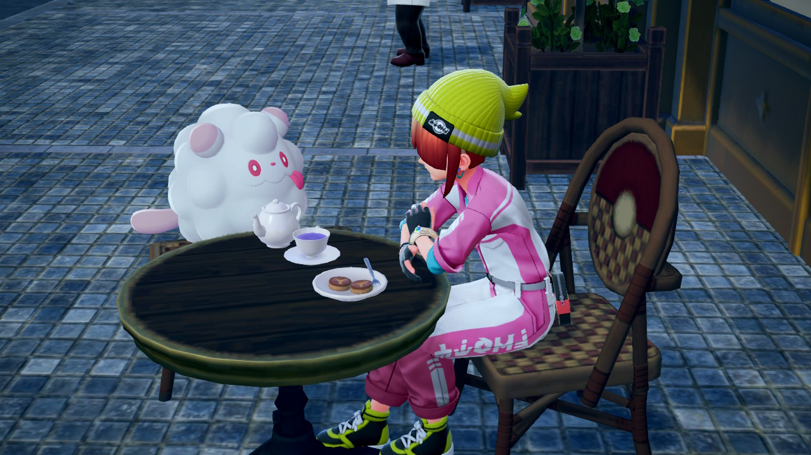

Hello! I’m Yage ([/jakɤ/](), or "yah-kuh" where the "k" is unaspirated) and I'm an incoming PhD student in Language Science at UC Irvine, starting Fall 2026. I recently graduated from UC San Diego double majoring in Linguistics and Cognitive Science (with a minor in Music). 

I want to believe that we can't fully understand language and cognition unless we understand the language and minds in different groups across various situations. Broadly speaking, my [research interrest](/research/) centers around pragmatics and theory of mind. This includes how theory of mind (and other cognitive devices) is/isn't involved in pragmatic reasoning, as well as its development and breakdown in language. I first became interested in this area thinking about communciation in autism, and now I want to approach this big topic using various methods from different aspects. 

Outside of academics, I am passionate about music and [art](https://www.instagram.com/mobigreus/), as well as reading and writing. 

{: width="270" height="130" }